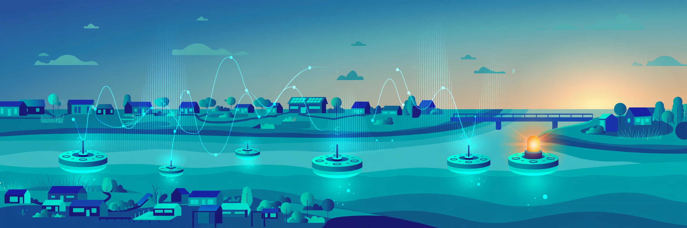

# 🌊 AquaWatch

[](https://sdgs.un.org/goals/goal6)
[](https://www.python.org/)
[](#testing)
[](LICENSE)
[](#)

**Crowd-sourced water-quality monitoring — know your water turned unsafe *before* the officials tell you.**

## The problem

When a creek turns brown or tap water smells off, communities find out through
rumor — days before any official notice. Boil-water advisories arrive *after*
exposure. People living near industrial outfalls, farms, and aging pipes have
no early-warning system of their own.

## The solution

AquaWatch fuses two data streams into one early-warning pipeline:

1. **Synthetic sensor network** — seeded, reproducible time series per
   monitoring station (pH + turbidity NTU), standing in for low-cost IoT probes.
2. **Crowd-sourced reports** — anyone can submit a reading
   (`location, pH, turbidity, timestamp, reporter`), validated on ingest.

Three detectors watch every station, an alert engine turns *sustained*
anomalies into severity-graded alerts, and a dashboard + charts make the story
visible at a glance.

## Demo (60 seconds)

```bash
pip install -r requirements.txt
python3 -m aquawatch.cli --db demo.db demo --out docs
# open docs/index.html
```

The demo ingests a synthetic week (5 stations × 168 hours) containing
**2 scripted contamination events**, runs detection, raises alerts with
simulated notifications, renders per-station charts, and builds the dashboard:

```
[demo] scripted event: Turbidity spike — suspected runoff event @ HW-03 (hour 96, 9h)
[demo] scripted event: pH crash — suspected acidic discharge @ HW-01 (hour 130, 7h)
[demo] detectors flagged 45 anomalies
[demo] alert engine raised 2 alerts:
🚨 [SIMULATED ALERT — no real message sent]
  Severity : CRITICAL
  Station  : Spencer Creek (HW-03)
  Window   : 2026-09-28T06:00:00 → 2026-09-28T11:00:00
  Details  : turbidity anomaly at Spencer Creek: 6 consecutive anomalous readings
             (peak turbidity 48.5 NTU, ...)
```

Other commands: `init-db`, `ingest-week`, `ingest-report --station HW-01 --ph 7.1
--turbidity 1.3 --reporter "Ava"`, `detect`, `analyze`, `alerts`, `chart`,
`dashboard`. Run `python3 -m aquawatch.cli --help` for all options.

## Features

- **Dual ingestion** — seeded synthetic sensor streams + validated crowd reports
  (pH 0–14, turbidity ≥ 0 NTU, known station) into SQLite.
- **Anomaly detection** (per station, per metric, causal trailing windows):
  - `RollingZScoreDetector` — |z| ≥ 3 vs. the prior 24 readings.
  - `IQROutlierDetector` — Tukey fences (Q1 − 1.5·IQR, Q3 + 1.5·IQR).
  - `PHBandGuard` — flags pH outside the 6.5–8.5 guideline band.
- **Alert engine** — `ConsecutiveAnomalyAlerter`: alerts fire only on ≥3
  consecutive anomalous timestamps (isolated blips never page anyone);
  severity is `critical` for turbidity peaks ≥ 20 NTU or pH < 6.0 / > 9.0,
  else `warning`. Simulated console notifications.
- **Charts** — matplotlib time series with anomaly markers, pH guideline band,
  and turbidity threshold line.
- **Dashboard** — static HTML: station status grid, recent-alerts table,
  embedded charts. Open `docs/index.html` — no server needed.
- **Bundled data** — `data/stations.csv`, `data/events.json`,
  `data/crowd_reports_sample.csv`: runs out of the box, fully offline, no API keys.

> **Note:** the pH 6.5–8.5 band is a general guideline shown for context only —
> **not medical advice**. Confirm water safety with your local utility.

## Screenshots

Time-series chart with anomaly markers (Spencer Creek turbidity spike):


Dashboard (`docs/index.html`, generated by the demo — station grid, alert table,
embedded charts):

The dashboard is a real generated artifact in this repo: open
[`docs/index.html`](docs/index.html) in a browser.

## Tech

| Layer | Choice |
|---|---|
| Language | Python 3 (stdlib + numpy + matplotlib) |
| Storage | SQLite (`stations`, `readings`, `alerts`) |
| Detectors | Rolling z-score, IQR/Tukey fences, pH guideline-band guard |
| Alerting | Consecutive-anomaly clustering → severity-graded alerts |
| Viz | matplotlib (Agg) → PNG; static HTML dashboard |
| Tests | pytest, 7 behavioral tests |

## Project structure

```
aquawatch/
├── aquawatch/
│   ├── db.py          # SQLite storage (stations, readings, alerts)
│   ├── synth.py       # seeded synthetic sensor stream
│   ├── ingest.py      # crowd reports + synthetic ingestion, validation
│   ├── detect.py      # RollingZScoreDetector, IQROutlierDetector, PHBandGuard
│   ├── alerts.py      # ConsecutiveAnomalyAlerter, severity, notifications
│   ├── charts.py      # matplotlib time-series charts
│   ├── dashboard.py   # static HTML dashboard generator
│   └── cli.py         # CLI incl. end-to-end `demo`
├── data/              # bundled synthetic data (stations, events, sample reports)
├── docs/              # hero banner, generated charts + dashboard
├── tests/             # pytest suite (7 tests)
├── requirements.txt
└── LICENSE (MIT)
```

## Testing

```bash
TMPDIR=~/workspace/.pytest-tmp python3 -m pytest -q
# 7 passed
```

Tests verify real behavior: injected spikes get flagged (z-score + IQR),
a clean seeded stream raises nothing, pH 5.0 trips the band guard while pH 7.2
doesn't, alerts fire only on consecutive anomalies (isolated blips stay silent),
large spikes escalate to `critical`, crowd-report validation rejects bad input,
and the CLI demo runs end-to-end producing exactly 2 critical alerts.

## Roadmap

- [ ] Real IoT ingestion (MQTT/LoRa) alongside the synthetic stream
- [ ] SMS/email/push notifications via pluggable notifier backends
- [ ] Geospatial heatmap of reports + station coverage gaps
- [ ] Seasonal baseline models per station (reduce false positives)
- [ ] Community trust scoring for crowd reporters
- [ ] Multi-language alerts for riverside communities

---
Built for UN SDG 6: Clean Water & Sanitation. MIT licensed.
